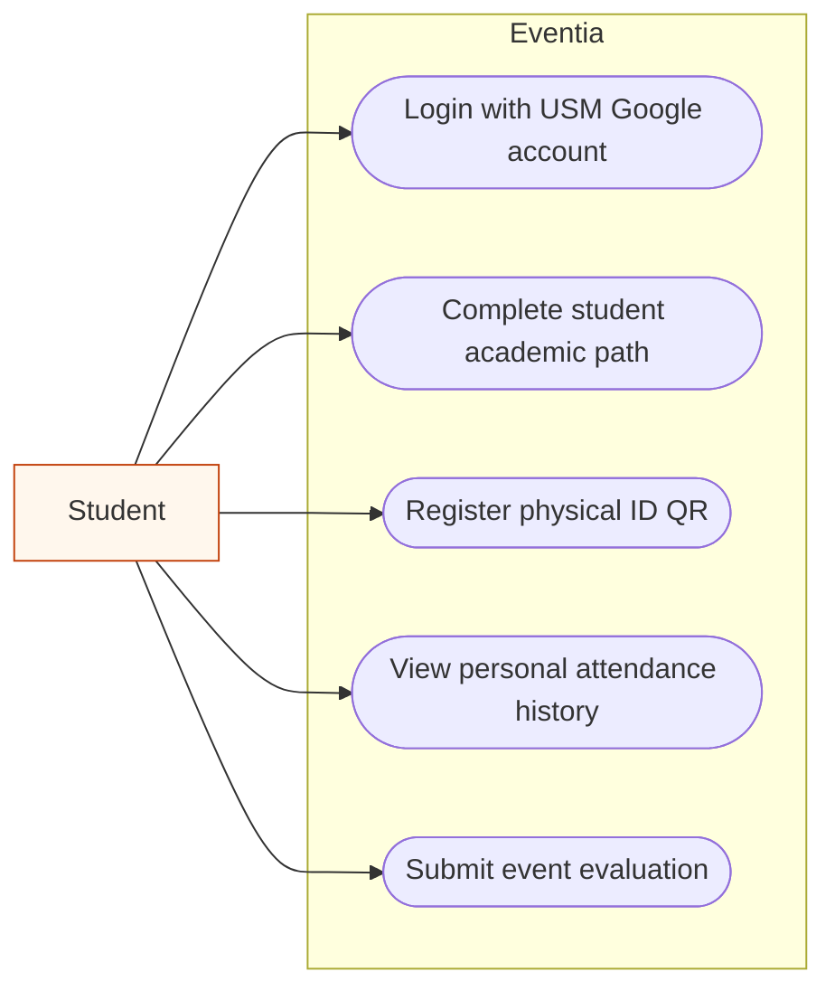
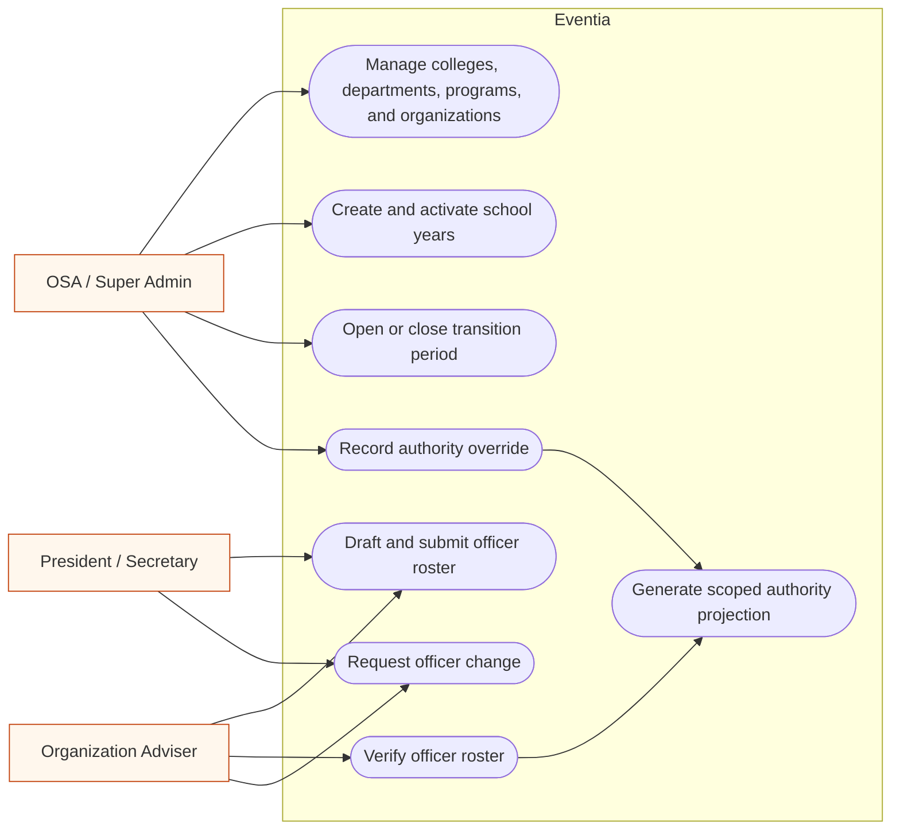
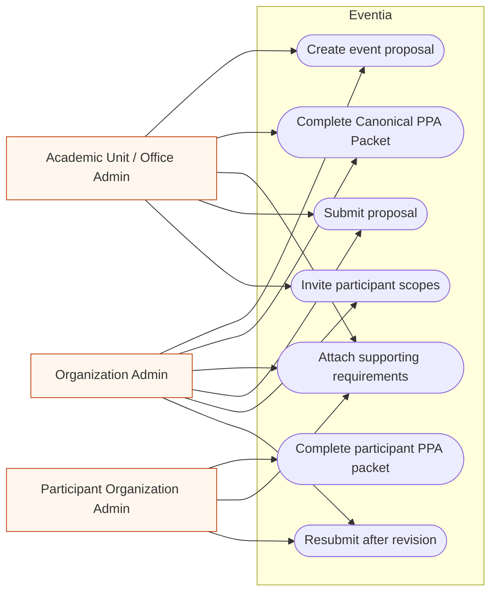
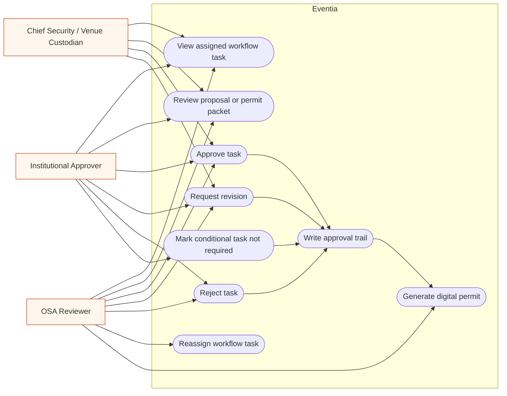
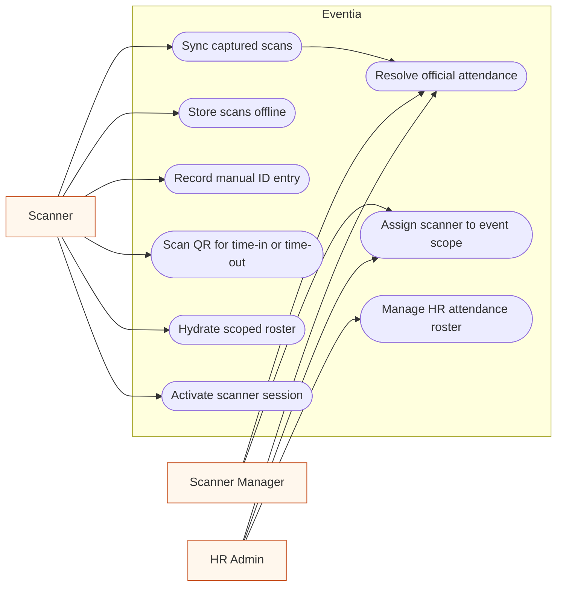
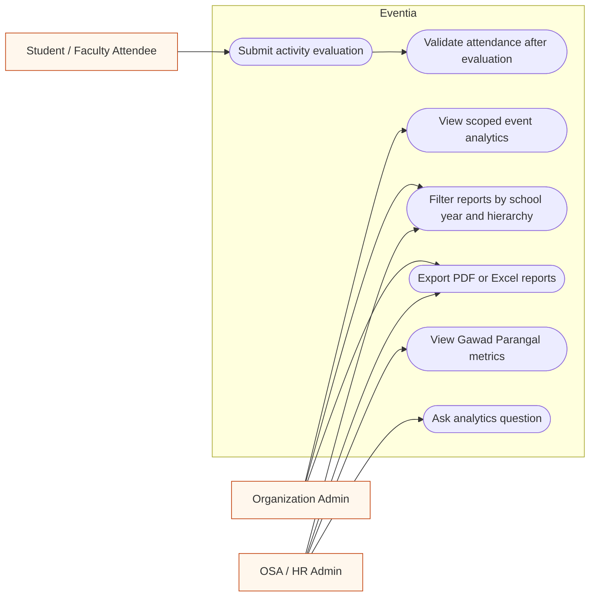

# Eventia Use Case Diagrams

Recommended count: **6 smaller use case diagrams**.

These diagrams are grouped by actor area so each diagram stays readable with only 2-3 actors or actor groups. Mermaid does not provide a native UML use-case diagram type, so these use `flowchart LR` with actor nodes outside the Eventia boundary and rounded use-case nodes inside it.

## 1. Student and Faculty Self-Service

Figure 1 presents the self-service use cases available to students and faculty or staff users in Eventia.

## 2. OSA and Officer Governance

Figure 2 shows the governance use cases handled by OSA, organization advisers, and verified organization officers.

## 3. Event Proposal and PPA Packet

Figure 3 presents the event proposal and Canonical PPA Packet use cases for organizer and participant-side administrators.

## 4. Approval Workflow and Digital Permit

Figure 4 shows the approval workflow, task decision, audit trail, and digital permit use cases for institutional approvers.

## 5. Scanner Assignment and Attendance Capture

Figure 5 presents the scanner assignment and attendance capture use cases for scanner managers, scanner operators, and HR administrators.

## 6. Evaluation, Analytics, and Reports

Figure 6 shows the evaluation, attendance validation, analytics, and report export use cases available after event participation.

