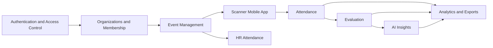

<!-- BEGIN GENERATED:eaes-knowledge -->
# USM EAES System Overview

The USM Event Attendance & Evaluation System is a Laravel 12 web/API backend and Flutter scanner companion app for event proposals, scoped attendance capture, evaluation-gated validity, analytics, exports, and AI-assisted insights.

Graphify remains the machine-readable structural source. This vault is a curated human architecture layer that intentionally avoids mirroring every class, method, route, or file.

## Major Domains

- [[Event Management]]
- [[Attendance]]
- [[Scanner Mobile App]]
- [[Organizations and Membership]]
- [[Evaluation]]
- [[Analytics and Exports]]
- [[Authentication and Access Control]]
- [[AI Insights]]
- [[HR Attendance]]

## Important Workflows

- [[Google Authentication]]
- [[Admin Assignment Governance]]
- [[PPA Approval]]
- [[Participant Scope Approval]]
- [[Scanner Assignment and Activation]]
- [[Attendance Scanning]]
- [[Offline Attendance Sync]]
- [[EILO Resolution]]
- [[Attendance Rules]]
- [[Evaluation Completion]]
- [[AI Sentiment and NLP]]
- [[Organization Analytics]]
- [[Analytics Export]]
- [[Event Lifecycle]]

## Cross-Cutting Concerns

- [[Authorization and Tenant Scope]]
- [[Offline Sync]]
- [[Queue and Concurrency]]
- [[Evaluation Gate]]
- [[Audit Logging]]
- [[Caching]]
- [[Device Binding]]

## Architecture Sketch

## How to Explore

Start with the major domains above. Use Obsidian's Local Graph when inspecting a domain, concept, or workflow so the surrounding architecture stays readable.

For raw implementation-level relationships, inspect:

`graphify-out/graph.html`

For machine-readable graph data:

`graphify-out/graph.json`

This generated vault referenced 2724 Graphify-backed implementation nodes across selected `Web/` and `Application/` files.

## Generated Content Boundary

Generated sections are wrapped in `<!-- BEGIN GENERATED:eaes-knowledge -->` and `<!-- END GENERATED:eaes-knowledge -->` markers. Manual notes can be added outside those markers and will be preserved by the sync script.

<!-- END GENERATED:eaes-knowledge -->
