<!-- BEGIN GENERATED:eaes-knowledge -->
# Architecture Map

#map

## Curated System Graph

```mermaid
flowchart TD
    System[USM EAES]
    System --> Auth[Authentication and Access Control]
    System --> Org[Organizations and Membership]
    System --> Event[Event Management]
    System --> Scanner[Scanner Mobile App]
    System --> Attendance[Attendance]
    System --> Evaluation[Evaluation]
    System --> Analytics[Analytics and Exports]
    System --> AI[AI Insights]
    System --> HR[HR Attendance]

    Auth --> Admin[Admin Assignment]
    Auth --> User[User]
    Auth --> Device[Device Identity]
    Org --> Organization[Organization]
    Org --> Membership[Organization Membership]
    Event --> PPA[PPA]
    Event --> Scope[Participation Scope]
    Event --> EventDay[Event Day]
    Scanner --> ScannerAssignment[Scanner Assignment]
    Scanner --> ScannerSession[Scanner Session]
    Attendance --> RawScan[Raw Scan]
    Attendance --> AttendanceRecord[Attendance Record]
    Attendance --> PendingLink[Pending Student Link]
    Evaluation --> EvalForm[Evaluation Form]
    Evaluation --> Eval[Evaluation]
    Analytics --> Export[Analytics Export]
    AI --> Sentiment[AI Sentiment and NLP]
```

## High-Impact Change Paths

- Changing [[Event]] or [[Participation Scope]] can affect [[Scanner Assignment and Activation]], [[Offline Attendance Sync]], [[Evaluation Completion]], and [[Organization Analytics]].
- Changing [[Scanner Session]] can affect [[Device Identity]], [[Attendance Scanning]], [[Offline Sync]], and backend authorization checks.
- Changing [[Attendance Record]] can affect [[Evaluation Gate]], [[Analytics and Exports]], [[Analytics Export]], and Gawad-style organization metrics.
- Changing [[Evaluation Form]] can affect [[PPA Approval]], [[Evaluation Completion]], sentiment processing, and exports.
- Changing [[Admin Assignment]] can affect every tenant-scoped dashboard, API, scanner, analytics, export, and AI query path.

<!-- END GENERATED:eaes-knowledge -->
